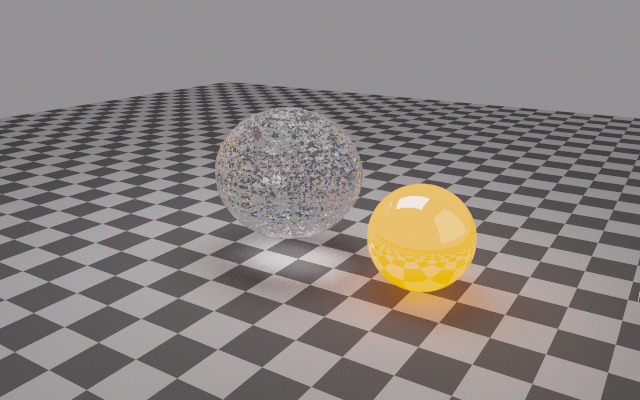

# CPU accuracy and performance

A subsequent [fluid CPU pass](cpu_round2.md) reuses flux and boundary work,
parallelizes RK updates and fixes limited solid face states. Its gains are
measured against this implementation.

The CPU fluid solver now estimates multiphase source stability from current
boundary states, and shares primitive conversions between spatial directions
when caching saves conversions. The CPU camera caches spectral medium data,
uses a 16-bin SAH BVH and early-exit shadow traversal, and replaces the
absolute triangle determinant cutoff with a ray-aligned shared-edge test.
Voxel traversal reuses crossing increments. Photon packet transport also
reuses wavelength-dependent coefficients; its energy/source model is unchanged.

## Measured comparison

Intel Core i7-13620H, eight Rayon threads, Battery profile, CPU maximum 50%,
no turbo. Release builds have thin LTO. The baseline is `6b3d5c9` (the old
solver/renderer plus the same benchmark harness); solver changes are
`eb82f49`, renderer changes `7763c41`. Four alternating old/new pairs per
workload ran sequentially. The first smooth-32 pair overlapped a short clippy
check; excluding that pair gives 1.10× instead of 1.08×. Times are medians;
these short runs do not establish statistically significant gains for every
grid. [Raw runs and parameters](cpu_optimization.json) retain all measurements.

| Workload | Previous median | New median | Previous/new |
|---|---:|---:|---:|
| Smooth 32³, 40 fluid steps | 0.635 s | 0.590 s | 1.08× |
| Smooth 48³, 40 fluid steps | 1.586 s | 1.640 s | 0.97× |
| Water/air interface 24³, 20 steps | 0.498 s | 0.422 s | 1.18× |
| Water/air interface 32³, 20 steps | 0.839 s | 0.839 s | 1.00× |
| Camera 192×120, 32³ fluid, 256 spectral paths/pixel | 6.351 s | 2.082 s | 3.05× |

The renderer's previous/new ranges are 6.295–6.682 s and 1.973–2.211 s.
Both use seed 42, 12 fluid steps, 5,240 interface triangles, depth cap 128
and 5,898,240 main wavelength paths. Timing includes image writes, as in
the original example. Mean luminance standard error decreases from 1.9601
to 1.6897 (14%); this is an estimator on this scene, not a certificate of
image error. All these runs report zero depth-truncated main paths.
Preparation includes the fluid and BVH construction, and stays around
0.6–0.8 s; the faster camera timing is not a claim that every fluid workload
is three times faster. Primitive caching adds one padded state-sized buffer
and can lose its benefit under memory pressure, as the 48³ probe shows.

The new renderer with exact thermal emission took 2.742 s in one diagnostic
run. Adaptive mode with the same maximum 256 paths took 2.599 s: its pilot
adds 1,474,560 paths and most pixels still choose the maximum (mean 251.66).
Thus fixed sampling remains the default. Adaptive savings depend on the
scene and noise target; this low-budget caustic example does not benefit.

## Accuracy checks

41 tests pass across radiation, compressible flow and semiconductors;
radiation passes clippy on all targets with warnings denied.

- Reflecting-boundary multiphase CFL matches the analytic source limit on
  the first step. Poisoning unused ghosts with NaNs leaves it unchanged;
  uniform periodic/outflow states receive only their physical limits.
- All old/new fluid probe pairs have identical interior conserved-state
  hashes, density errors and interface equilibrium errors. Caching changes
  work scheduling without changing numerical arithmetic in these probes.
  Interface pressure drift is below 2.5e-14 relative and velocity drift below
  2.6e-13 in the reported 24³/32³ runs.
- Triangle hits at shared edges and vertices pass at scales 1e-12, 1e-9,
  1 and 1e9. Closest-hit and shadow queries match exhaustive sphere searches.
- The wavelength PDF retains full support and integrates the observer
  correctly; an adaptive constant blackbody image agrees with independent
  spectral quadrature within 0.5%. Main samples are independent of the pilot.
- Pathwise exact/budgeted emission comparisons include scattering and
  roulette weights. Omitted emission stays within the supplied absolute
  spectral radiance budget. Existing slab, attenuation, energy, momentum,
  diffusion and thread reproducibility tests continue to pass.

The smooth probe uses a periodic advected density wave at t=0.02,
40 fixed RK steps and the central spatial scheme. Density L1 errors at
16³/24³/32³/48³ are 5.139e-8, 4.583e-9, 8.208e-10 and 7.234e-11,
respectively (observed order about 6). Refinement confirms the existing
spatial accuracy; the
boundary fix improves stability estimates rather than raising the method's
formal order. Shocks, phase transitions and sub-grid geometry still need
appropriate resolution and their existing physical closures.

## Source budget and adaptive sampling

Medium coefficients are evaluated once per wavelength history. Default
camera rendering may omit volume thermal emission only when a conservative
bound fits within the remaining per-history budget of 1e-6 W m⁻² sr⁻¹ m⁻¹.
For absorption optical depth x, `1-exp(-x) <= min(x,1)` and the maximum
snapshot temperature bounds Planck radiance. The bound includes current
throughput, refractive-index squared and roulette amplification. Budgets
are deducted over the whole history; absorption/scattering remain exact
for the piecewise-constant snapshot. Packet source physics is unchanged.
`Scene::radiance` is exact, and `render_with_budget(..., 0.0)` / `exact`
mode disable omission for images. The bound addresses only this source
approximation, not mesh, finite-depth or Monte Carlo errors.

CIE importance sampling uses a 1 nm piecewise-constant PDF with a positive
floor, four strata and exact reciprocal-PDF weights. It does not interpolate
or approximate the physical spectrum. Adaptive rendering discards an
independent pilot, chooses a fixed main budget per pixel from its luminance
variance, then averages only the main samples. Targets are estimates;
a pilot may miss rare caustics. Actual main counts and total pilot work are
recorded in `Image` and example metadata.

## Full-size result

The [new 640×400 image](radiation_cpu.png) uses the same 48³ grid, 12 fluid
steps and 2,048 main spectral paths/pixel as the historical demo. It rendered
in 269.626 s with eight threads under the same Battery profile, with zero
depth-truncated paths and mean luminance standard error 0.56548.
[Metadata](radiation_cpu.txt) records the 524,288,000 main paths and source
budget. The HDR remains at `fluid/renders/cpu-final/photons.pfm` (generated,
not committed). The historical image took 714.54 s with some overlapping
checks; that is context, not the controlled comparison used in the table.
The resolved mesh remains visibly faceted and caustic Monte Carlo noise
remains; this optimization does not add sub-grid surface detail or denoising.



## Reproduce

```sh
cd fluid
cargo test -p radiation -p compressible -p semiconductor --release --lib --tests
cargo clippy -p radiation --all-targets -- -D warnings
cargo build -p compressible --release --example cpu_validate --example photon_render
RAYON_NUM_THREADS=8 target/release/examples/cpu_validate smooth 32 40
RAYON_NUM_THREADS=8 target/release/examples/cpu_validate interface 24 20
RAYON_NUM_THREADS=8 target/release/examples/photon_render renders/cpu-small 32 256 192 12 fixed
RAYON_NUM_THREADS=8 target/release/examples/photon_render renders/cpu-exact 32 256 192 12 exact
RAYON_NUM_THREADS=8 target/release/examples/photon_render renders/cpu-adaptive 32 256 192 12 adaptive
```

For the old/new comparison, build the same examples in separate checkouts
of `6b3d5c9` and `7763c41`, finish both builds, then alternate executions
with matching arguments, thread counts and power settings. Run no build or
other heavy workload during timing. Absolute results depend on the host.

The BVH design follows the [surface-area heuristic](https://www.pbr-book.org/4ed/Primitives_and_Intersection_Acceleration/Bounding_Volume_Hierarchies),
and the triangle test uses a [ray-aligned transformation](https://pbr-book.org/4ed/Shapes/Triangle_Meshes).
