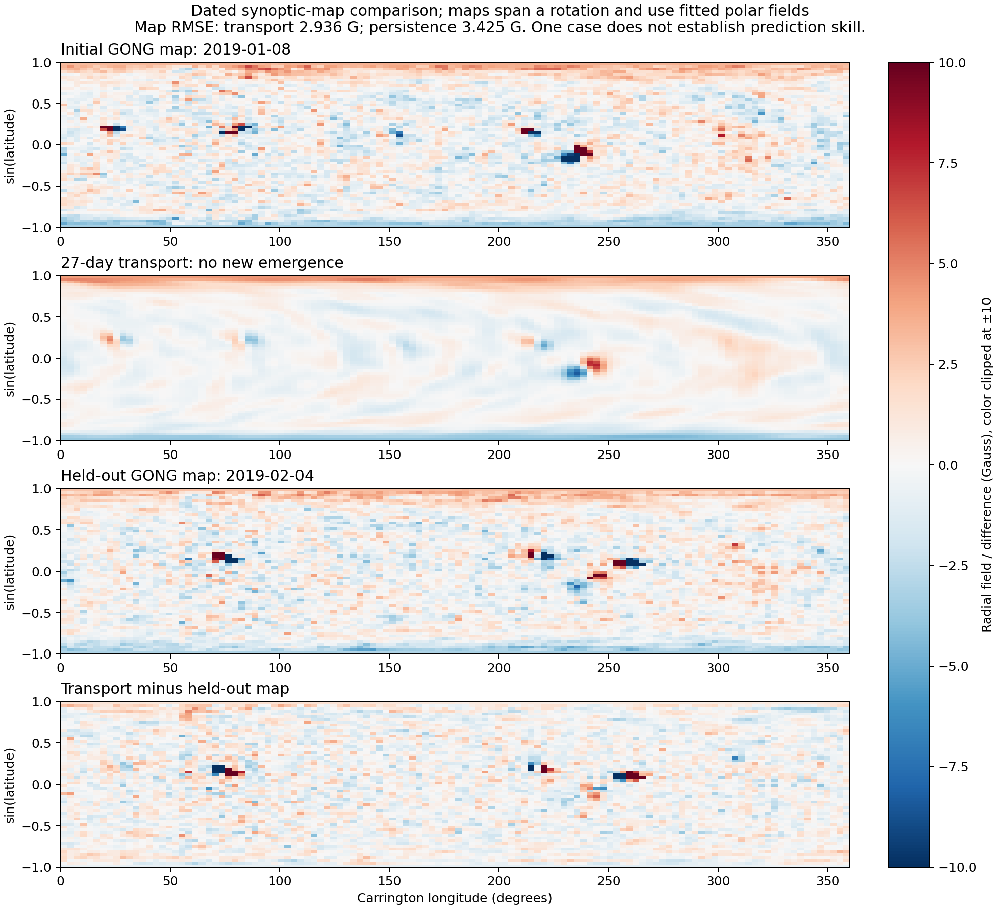

# Gravity and solar magnetic transport

The results below describe the initial implementation. A subsequent
[rendering and numerical accuracy update](solar_render.md) adds L-stable
diffusion, integration of magnetogram cell areas and physical continuum rendering.

Implemented October 5, 2026. This extends the
[relativistic particle module](standard_model_relativistic.md) with isolated
gravity, static spacetime geodesics and reduced solar magnetic models.
[Gravity API](../fluid/crates/gravity/README.md) and
[solar API and provenance](../fluid/crates/solar/README.md) describe units,
domain guards and source data.

Gravity now acts on bulk fluid density and on elementary test particles. The
stellar background uses published Model S density and thermodynamics, rather
than treating the solar interior as a point mass. An exact shell representation
handles spherical backgrounds; a quadrupole octree handles nonspherical macro
sources. Particle transport includes local proper-time decays, gravitational
redshift and spatial curvature. Conservative fluid impulses preserve internal
energy, but a fully hydrostatic/self-gravity energy-conserving advection closure
still needs implementation.

The magnetic model evolves surface radial flux under prescribed differential
rotation, meridional circulation and effective diffusion. The full two-dimensional
map retains magnetic-region structure. Its exact discrete longitude-average
reduction retains mean/polar-field evolution with less work under the same
linear coefficients. A nonaxisymmetric potential-field source-surface model
supplies a current-free coronal baseline, not an eruptive corona.

## Numerical validation

The six affected crates pass **128 library/integration tests**, with one
Standard Model documentation test. Strict Clippy passes for gravity, solar and
Standard Model across all targets. Formatting passes for those crates and the
new compressible source/test files. Commands from `fluid/`:

```sh
RAYON_NUM_THREADS=8 cargo test -p gravity -p solar -p standard-model -p compressible -p radiation -p semiconductor --release --lib --tests
cargo test -p gravity -p solar -p standard-model --release --doc
cargo clippy -p gravity -p solar -p standard-model --all-targets --no-deps -- -D warnings
cargo fmt --check -p gravity -p solar -p standard-model
rustfmt --edition 2021 --check crates/compressible/src/gravity.rs crates/compressible/tests/gravity.rs
```

Independent physical checks cover:

| Check | Criterion |
|---|---|
| Uniform/hollow spheres | Analytic interior/exterior potential and shell theorem |
| Quadrupole tree | Direct-force comparisons, source exclusion, numerical potential gradient |
| Newtonian binary | Bounded energy and conserved momentum over 20 orbits with direct forces |
| Relativistic motion | Flat-space limit, massive equivalence principle, solar-limb `4GM/(bc²)` bending, gravitational redshift, Killing energy, proper-time decays and partition consistency |
| Fluid impulse | Exact kinetic work, unchanged pressure/internal energy, atomic rejection |
| Model S | Published central values, integrated mass within 1e-4, hydrostatic residual below 0.5% at five interior radii |
| Surface transport | Analytic dipole diffusion and exact rotation; second-order temporal and spatial convergence against a meridional characteristic solution |
| Mean reduction and sources | Full/folded agreement, signed flux conservation, normalized bipolar flux, atomic rejection |
| Coronal baseline | Analytic dipole, radial outer boundary, nonaxisymmetric curl/divergence and regular poles |

These check the implemented closures. They do not validate a full solar dynamo,
nuclear evolution or eruption forecast.

## CPU measurements

Three sequential release runs after compilation, with `RAYON_NUM_THREADS=8`
and unchanged power profile. The gravity query loop is serial. Median timings
and per-run speed ratios are in [raw results](gravity_solar_results.json).

| Workload | Result |
|---|---|
| Synthetic uniform cube: 32,768 sources, 256 queries, theta 0.35, softening 0.01 R | Tree build 7.69 ms; direct queries 130.08 ms; tree queries 21.07 ms; median per-run speedup 6.02× |
| Same force comparison | Relative RMS acceleration error 1.3301e-4 (0.0133%); 467,391 direct leaf interactions versus 8,388,352 reference pairs |
| One year of transport, 60×120 GONG starting map, no new emergence | Full model 262.60 ms; folded 60×1 model 3.484 ms; median per-run speedup 75.39× |
| Same mean comparison | Maximum mean-field difference 3.253e-18 T; both axial dipoles 1.266294992 G |
| Dated 27-day comparison | Transport 19.59 ms, excluding initialization/scoring |

These timings depend on source distribution, resolution, requested accuracy
and machine load. They exclude stellar evolution, source assimilation and
eruption physics. Tree force approximation does not enforce exact pairwise
momentum conservation. Use direct diagnostics and refine theta/time steps when
conservation accuracy matters.

## One held-out observation comparison

The demonstration uses two publicly archived GONG radial synoptic maps, with
fixed default coefficients and no future emergences or target fitting. It
starts at 2019-01-08 11:14 UTC and advances 26.993055556 days to 2019-02-04 11:04.
Preparation aligns absolute Carrington longitudes, conservatively averages 3×3
equal-area cells to 60×120, and converts Gauss to tesla. Both maps receive the
same Nyquist removal and explicit mean subtraction. Removed means are
0.100274973 G initially and 0.108258766 G for the target. URLs and content hashes
are in the [data manifest](../fluid/crates/solar/data/gong_provenance.json).

| Metric | Transport | Persistence |
|---|---:|---:|
| Area-weighted map RMSE | 2.935806626 G | 3.424812275 G |
| Map MSE skill relative to persistence | 0.265179354 | 0 |
| Predicted axial dipole | 1.247926693 G | 1.237658785 G |
| Absolute axial-dipole error, observed 1.189862850 G | 0.058063843 G | 0.047795935 G |

Transport improves full-map MSE by **26.5% in this case**, while its dipole
forecast is worse than persistence. This is a useful mixed result, not evidence
of calibrated cycle forecasting. Signed flux drift over the comparison is
0.04245 Wb, negligible relative to solar magnetic flux scales.



To reproduce the figure after writing a forecast CSV:

```sh
cd fluid
cargo run -p solar --release --example hindcast -- /tmp/solar_forecast.csv
cd ..
python3 analysis/solar_comparison.py /tmp/solar_forecast.csv
```

Synoptic maps combine observations over a rotation and have fitted polar fields;
they are not simultaneous full-Sun states. This comparison is not a substitute
for multiple forecast origins, strict observation-time accounting, independent
cycles, source ensembles, spatial/time convergence, uncertainty calibration or
comparison against operational forecasts. [NSO product documentation](https://magmap.nso.edu/)
describes the observation conventions.

## Requested prediction targets

For cycle strength/timing, the efficient polar-field model is now available,
but a calibrated cycle relationship and interior dynamo are absent. For magnetic
regions, resolved surface transport is implemented, but observed emergence and
flow assimilation are needed. For flares/CMEs, PFSS supplies topology and open
flux; it contains no currents or reconnection and cannot produce an eruption
prediction. A current-carrying evolving corona with vector boundary observations
and energy/helicity injection is required.

Model S is a structural reference, not an evolved Sun. Composition-dependent
EOS, nuclear reactions, radiative/convective transport and dynamically coupled
induction remain substantial work. The current low-Rm imposed-field solver is
not a solar dynamo. The [surface flux transport review](https://arxiv.org/html/2303.01209)
motivates this prescribed-flow reduction; [Mackay and Yeates](https://link.springer.com/article/10.12942/lrsp-2012-6)
describe the coronal approximation. Claims of an emergent, validated predictive
Sun would go beyond the implementation and evidence here.
