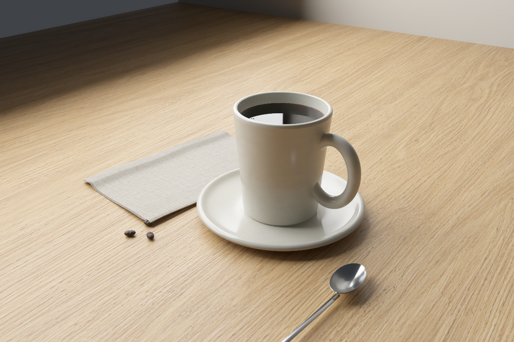

# Native Rust tabletop



The final frame is computed entirely by Rust. Imagegen supplied only flat wood
and linen material maps in [assets/](assets/README.md). The earlier
[imagegen scene](photographic-version.png) is kept as a visual reference and is
not used as a background, compositing layer or final-image edit.

[Liquid detail](native-v2/liquid-detail/native.png) uses the same materials,
geometry and transport with a closer camera. Both views retain an unfiltered
PNG and a linear-light PFM alongside the displayed image.

The new [scene example](../../fluid/crates/viz/examples/native_still_life.rs)
uses the reusable [RGB path tracer](../../fluid/crates/viz/src/pbr.rs), the
project's triangle meshes and camera, accelerated geometry BVH ray queries,
and existing Fresnel/refraction optics. Rendering includes:

- A hollow, curved ceramic mug and saucer with estimated rough glaze, a thin
  concave metal spoon, and irregular bean geometry.
- Absorbing, refracting coffee whose volume follows the actual mug interior.
  The free surface uses an axisymmetric hydrostatic Young–Laplace boundary
  solve in `wetting::meniscus`, with sourced water-like properties and an
  estimated imposed wall height.
- Explicit hollow bubble shells with two refracting interfaces and estimated
  8 μm film thickness. Placement and radii are prescribed. The maximum Bond
  number is below 0.14; spherical bubbles neglect gravitational deformation.
- Two closed linen sheets with folds and hems. Generated albedo, estimated
  micro-relief, mip filtering and anisotropic rough reflection supply weave
  appearance. The cloth shape is prescribed, not a cloth mechanics solution.
- Eight finite window panes, opaque mullions, direct-light/BSDF multiple
  importance sampling and indirect illumination. Window radiance is an
  estimate in relative RGB units, not a measured sky or glass-window model.
- Thin-lens camera blur and deterministic pixel/sample seeds. The first
  dielectric reflection is integrated directly when it reaches a known
  emitter or environment; indirect reflections continue tracing.

Material indices, RGB reflectances, absorption, roughness, relief and camera
settings are sourced or marked as estimates in the code. Textures are not
measured reflectance/height data. RGB transport omits spectral dispersion,
polarization and thin-film interference. GGX is single scattering, and the
coated-diffuse model neglects coating interreflection. Shading normals and
normal maps are approximations. Paths stop after 24 interactions; no rigorous
whole-image error bound or measured photographic match is claimed.

The displayed image uses a conventional Rust albedo/normal/geometry-guided
spatial noise filter, exposure, highlight rolloff and sRGB encoding. Filtering
introduces bias. `native-unfiltered.png` shows the same exposure without the
filter; `native-linear.pfm` retains unfiltered linear radiance. All assembly,
filtering and display conversion remain native Rust.

The saved frame improves material detail and light transport, but still looks
rendered: the mug and cloth geometry are regular, and the small bubble cluster
does not yet read convincingly as a photograph. This is not a demonstrated
photographic match. The full frame took 948.262 s and the detail 446.083 s of
rendering on this machine, excluding compilation and assembly. Settings and
measured run times are in [run-summary.json](native-v2/run-summary.json).

## Numerical validation

Every new test is well under 30 seconds. The tests compare against independent
exact results or published microfacet equations, without fitting parameters
to a benchmark target.

| Check | Result |
|---|---|
| Axisymmetric meniscus vs exact small-slope Bessel solution | max height error 8.45749e-15 m |
| Nonlinear meniscus, 256 and 512 intervals vs 2048 | max height change 4.20870e-11 → 2.59244e-12 m |
| BVH triangle rays vs exact box faces, shared edges included | max distance error 0 on tested rays, no missed edge cases |
| GGX projected-density normalization, three roughness pairs | max integral error 4.09138e-7 |
| Coated GGX sampled reflectance vs independent quadrature | 0.645293397 vs 0.645746300; absolute error 4.52903e-4 |
| Finite window light with MIS vs exact rectangle irradiance | 0.115071688 vs 0.115126005; absolute error 5.43169e-5 (0.0472%) |
| Diffuse furnace, clear slab, hollow bubble film | exact radiance within 1e-13 test tolerance |
| Homogeneous absorption | exact Beer–Lambert factors within 1e-15 |
| Linear texture filtering and PFM row/endian conversion | exact test fixtures |
| Restarted row bands vs one stochastic render | identical in-memory pixels |

The published rough-reflection and visible-normal references are
[PBRT 4e](https://www.pbr-book.org/4ed/Reflection_Models/Roughness_Using_Microfacet_Theory)
and [Heitz 2018](https://jcgt.org/published/0007/04/01/). Triangle intersection
follows [PBRT's sheared edge-function construction](https://www.pbr-book.org/4ed/Shapes/Triangle_Meshes).
Water properties and the capillary equation sources are recorded in the
existing wetting crate. These checks validate numerical pieces and their
stated closures; they do not validate a dynamic coffee/foam/cloth simulation.

The affected `viz`, `wetting` and `geometry` suites pass 59 tests. Clippy has
21 pre-existing `viz` library warnings; the new renderer/example is clean.

## Reproduce

From `fluid/`, render all rows directly in a terminal:

```sh
cargo run -p viz --release --example native_still_life -- ../analysis/photographic_scene/reproduced 1200 512
```

For bounded, restartable jobs, render row ranges into the same fresh directory,
then assemble. For a 1200×800 frame:

```sh
cargo build -p viz --release --example native_still_life
for start in 0 100 200 300 400 500 600 700; do
  end=$((start + 100))
  target/release/examples/native_still_life ../analysis/photographic_scene/reproduced 1200 512 "$start" "$end"
done
target/release/examples/native_still_life ../analysis/photographic_scene/reproduced 1200 512 assemble
cargo test -p viz -p wetting -p geometry
```

Append `--detail` to each render and assembly command to use the close camera.
The detail frame is 800×533 at 256 samples per pixel. Rendering records source,
texture and setting fingerprints; incompatible jobs are refused rather than
silently mixed. Gaps and overlaps are refused during assembly. Per-band logs
record execution times, excluding compilation. Texture prompts and tool
provenance are saved in `assets/texture-prompts.json`.

The first sphere-traced draft and its original measurements are preserved in
[first-render-notes.md](first-render-notes.md).
