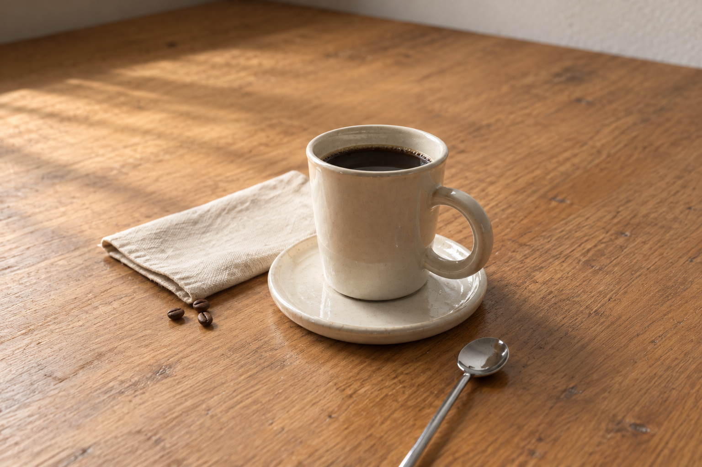
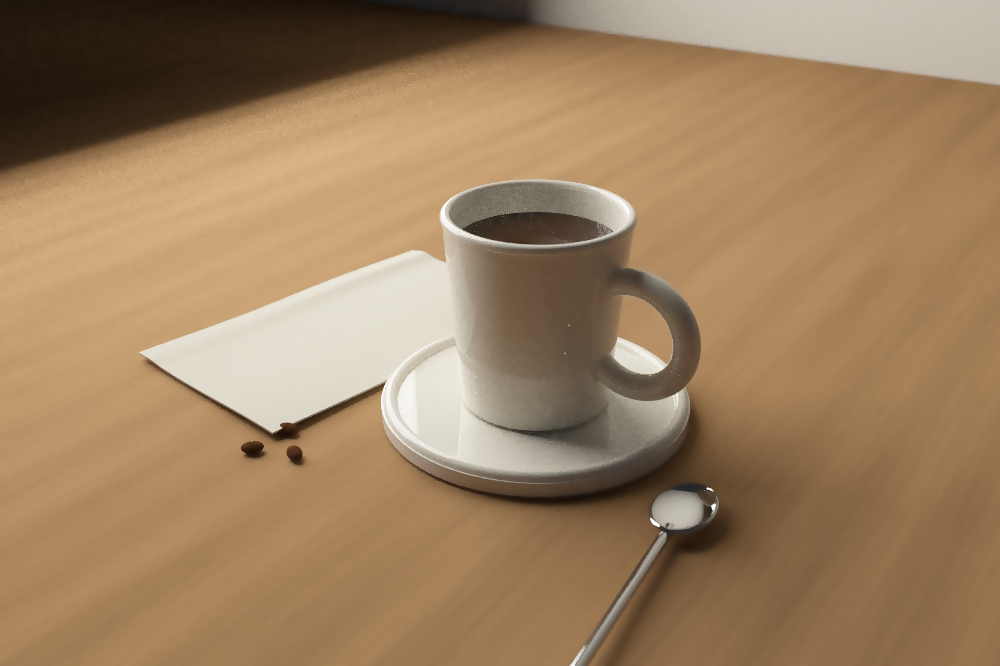

# Window-lit tabletop



The image above is a **built-in imagegen edit of the project's render**.
It refines the materials and photographic appearance while retaining the
scene's composition. It is a generated visualization, not a measured
photograph or a validated light-transport output. The exact edit prompt is
saved in `photographic-prompt.txt`.

The **native Rust output** is preserved separately:



A ceramic coffee cup and saucer, spoon, linen and coffee beans on a
procedurally textured wooden table. The scene uses `cad::Solid`, `viz::Camera`,
the project's sphere marcher, and `radiation::optics` Fresnel coefficients.
The example adds RGB diffuse textures, a sampled rectangular window,
indirect illumination and smooth reflective coats. It uses no generated
image assets or external renderer.

`tabletop.png` has exposure, a highlight shoulder, sRGB encoding, and a
two-pass bilateral noise filter. `tabletop-raw.png` has the same exposure
without filtering. `tabletop-linear.pfm` retains the original unfiltered
linear RGB. Filtering is a display approximation that introduces bias.

The materials, texture scales and illumination are estimates for appearance.
RGB reflectances are not measured spectra; ceramic and coffee use ideal
smooth coats; the spoon uses estimated, wavelength-independent conductor
indices. The linen has prescribed folds in a conservative implicit field;
it does not solve cloth mechanics. Transport stops after eight
bounces. The scene has not been validated against a measured photograph, and
photographic realism is a visual goal, not a numerical accuracy claim.

The rectangular-light estimator was checked against the exact parallel
rectangle irradiance integral: **0.230253076655** versus **0.230252010785**,
absolute error **1.06587e-6** (relative **0.000463%**) with 200×200 midpoint
quadrature. The texture test checks reflectances remain in [0,1]. Both
example tests and all 29 existing `viz` integration tests passed. Strict
Clippy encounters 21 pre-existing library warnings; the example's warning
was corrected.

From `fluid/`:

```sh
cargo run -p viz --release --example photographic_scene -- ../analysis/photographic_scene 1000 192
cargo test -p viz
cargo test -p viz --example photographic_scene -- --nocapture
```

To repeat display processing on an existing linear render:

```sh
cargo run -p viz --release --example photographic_scene -- ../analysis/photographic_scene 1000 192 --develop
```

The final native render is 1000×666 at 192 samples per pixel. It took
149.58 seconds on this machine and recorded 10 exhausted march queries.

The original render dimensions, sample count, runtime and exhausted march
query count are recorded in `metadata.json`. These are numerical diagnostics,
not a bound on image error.
