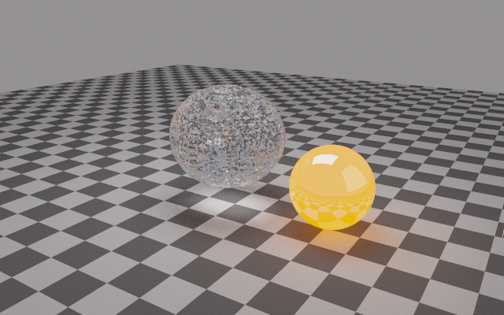

# Photons, radiation dynamics and simulation images

Implemented in `fluid/crates/radiation`, with solver adapters in
`compressible::radiation`. The camera renders actual fluid snapshots.
Radiation energy sources are explicit operators; existing simulations do
not acquire illumination or radiation heating without being configured.

## Shared physics

The incoherent, static-medium transfer equation is

\[
  c^{-1}\partial_t I_\lambda + \Omega\cdot\nabla I_\lambda =
  -(\sigma_a+\sigma_s) I_\lambda +
  \sigma_s\int p(\Omega,\Omega')I_\lambda(\Omega')\,d\Omega' +
  \sigma_a B_\lambda(T).
\]

Absorption, scattering and emission are per metre, not per cell. Optical
depth is their path integral. Thermal emission and absorption share
Kirchhoff's law. Planck radiance uses SI units per metre of wavelength;
the colour integral includes the wavelength sampling PDF and metre units.
Unpolarized dielectric and conductor reflection uses exact Fresnel
relations. Dielectric transmission uses Snell's law and the radiance
factor (n_incident/n_transmitted)^2; energy packets in the gas solver keep
their energy through elastic scattering.

Water's dispersive complex refractive index comes from Hale–Querry at
298 K, and iron's from Johnson–Christy at room temperature. Intensity
absorption is 4πk/λ. The complete tables and source links are checked in
under `radiation/data`. These are independent of the mechanical EOS.
Room-temperature optical constants are not a calibration for molten iron.
The demo's 1800 K iron object illustrates Planck emission with a polished
conductor emissivity; its temperature is prescribed scene data.

## Computational models and their limits

| Model | Work saved | Eligibility / present implementation |
|---|---|---|
| Local grey exchange | implicit scalar solve avoids absorption-time steps | fixed Cv and Planck-mean opacity, thermal equilibrium within a cell; energy conserved |
| Diffusion | O(n) tridiagonal solve replaces large numbers of scatter events | closed 1D uniform grid; transport depth ≥10 in every cell; isotropic smooth field assumed |
| Angular packets | many photons share one weighted history | arbitrary Cartesian 3D gas/diffuse snapshots, HG scattering, static n=1 transport, open boundaries |
| Spectral camera | follows paths that contribute to the camera | BVH interface meshes, ideal dielectrics, polished conductors, volume optics and area lights |

`Indicators::regime` additionally checks the mean-free-path/gradient-scale
ratio, reduced flux, directional structure, absorption equilibration, LTE
departure, and wavelength/feature scale. Its thresholds are engineering
eligibility checks, not a certified universal error bound. Two crossing
beams can have zero net flux and still require angular transport: the
directional-structure flag prevents this false diffusion decision. A
feature comparable to the wavelength is flagged as requiring wave optics.
There is no automatic 3D diffusion/packet handoff or M1 solver yet.

The 1D thick operator uses

\[
  D=c/[3(\sigma_a+(1-g)\sigma_s)],\quad
  \partial_t E=\partial_x(D\partial_x E),
\]

with harmonic face diffusivity and backward Euler. Supplied grey diffusion
opacities must represent the appropriate transport/Rosseland mean; the
emission opacity represents the Planck mean. They need not be equal.
No diffusion stencil is applied across a vacuum or thin-cell boundary.

Local exchange solves

\[
  E^{n+1}=E^n+c\kappa_P\Delta t(a(T^{n+1})^4-E^{n+1}),\quad
  C_V(T^{n+1}-T^n)=E^n-E^{n+1}.
\]

The monotone temperature equation is bracketed and solved by bisection.
The fluid adapter uses the actual volumetric Cv supplied by its system.
The Euler system now provides ρCv directly, correcting its former default
ρCp/1.4 for gases whose gamma differs from 1.4. Phase transitions need
the enthalpy/EOS relaxation after a source step; the frozen-Cv exchange
does not by itself solve a latent-heat plateau. The adapter checks the
post-source temperature and phase temperatures against that closure, and
rejects the entire update atomically if heating leaves it.

## Packet accounting and fluid coupling

Packets carry wavelength, energy, direction, position and an independent
random stream. Their photon count is Eλ/(hc). Voxel DDA integrates each
constant-cell segment exactly and advances all tied axes at corners.
Scattering histories use implicit capture and HG angles. Each collision
tallies absorbed energy and the incoming-minus-outgoing photon momentum.

Finite steps leave surviving packets at their physical positions. An event
budget returns the packet AND its remaining flight time: that backlog must
be resumed before proceeding to the next fluid step. The budget never
converts unprocessed energy into heat or silently deletes it. Histories
have private tallies and run in parallel, avoiding scatter-write races.

`emit_band` creates isotropic narrow-band thermal packets and opposite
matter energy/momentum withdrawals. It rejects an exhausted thermal
budget rather than altering the emitted spectrum. This is centre
quadrature of a supplied wavelength bin; multi-band integration requires
enough bins to resolve the spectrum.

The fluid adapter accumulates signed source terms, checks every updated
state, then commits all cells. Total energy receives the photon energy
increment once; the momentum increment draws its kinetic energy from
that same total. The all-speed carried-pressure cache is invalidated.
This is static, leading-order v/c coupling, not a relativistic radiation
hydrodynamics or moving-medium frequency-shift model.

Refractive surfaces currently belong to the camera. Gas packet deposition
does not model water-interface radiation pressure, dielectric momentum
exchange, or refractive light-speed changes. No photocarrier generation,
photoionization, fluorescence, coherent/polarized waves, diffraction,
gamma interactions or universal per-element optical database is claimed.

## Rendering actual fluid fields

`compressible::radiation::snapshot` maps each primitive cell to a medium,
opacity scale and temperature. The example evolves a water/air droplet
with surface tension and an internal bubble, then extracts the α_water=0.5
surface by consistently oriented marching tetrahedra. The mesh follows
the resolved grid; it adds no hypothetical sub-grid ripples. Phase
fraction scales volume absorption, and the snapshot supplies temperature.
Rendering is read-only and checks that the fluid state remains unchanged.

The camera traces 380–780 nm spectra using a full-support CIE importance PDF. Each four-wavelength bundle uses
common random numbers but retains separate dispersive paths. That reduces
colour noise without pretending different wavelengths refract identically.
Area sources are sampled explicitly at diffuse/volume vertices. Emission
on an explicitly sampled source is omitted after those continuations to
avoid counting it twice; specular continuations still reach emitters.
Russian roulette controls path length. The finite depth cap is counted,
and per-pixel luminance standard errors are available. Rare caustics can
still have high variance; these error estimates are not deterministic
certificates. BVH traversal uses a fixed stack and visits nearer nodes
first, without an allocation per ray. Independent pixel streams make
results bitwise reproducible across CPU thread counts.

PNG applies exposure, Reinhard compression and sRGB for display. PFM
retains unexposed floating-point linear RGB. Colour matching uses the
published Wyman–Sloan–Shirley analytic CIE fit, not the exact CIE tables.
This is a CPU implementation. CUDA tracing, rough/microfacet materials,
production denoising and measured ice/liquid-nitrogen optics remain open.

## Validation

24 tests now cover optics, transport, rendering and fluid coupling;
the existing 8 compressible and 7 semiconductor unit tests also pass.

| Check | Result |
|---|---|
| Integrate Planck over wavelength, 100–6500 K | Stefan–Boltzmann within 2e-9 relative |
| Dielectric/conductor normal-incidence Fresnel, Snell and total internal reflection | analytic values to roundoff |
| HG normalization and mean scattering cosine, g=-0.6/0/0.8 | normalization within 1e-7, sampled mean within 0.006 |
| Heterogeneous voxel attenuation, reverse and corner rays | exact piecewise-constant Beer–Lambert to roundoff |
| 40,000 packets through τ=2 slab | transmission within 0.004 absolute of exp(-2); total energy/momentum conserved |
| Stiff exchange, Cv=1–4e6 and cκΔt=1e-12–1e12 | positive, conservative; stiff limit reaches LTE within 1e-9 relative |
| Closed diffusion cosine, 16/32/64 cells | RMS 3.243e-4 / 8.123e-5 / 2.032e-5; second order |
| Camera absorption/emission slab | analytic transfer solution to roundoff |
| Lambert uniform environment, thermal conductor Kirchhoff law, closed dielectric radiance | analytic limits to roundoff |
| Thermal packet withdrawals and recoil, paused flights, atomic source rejection, snapshots | accounting and lifecycle checks pass |
| Render with 1 and 3 CPU threads | identical image values |

Reproduce:

```sh
cd fluid
cargo test -p radiation --release
cargo test -p compressible --test radiation --release
cargo test -p compressible -p semiconductor --release --lib
cargo run -p compressible --release --example photon_render -- renders/final 48 2048 640 12
```

The image shows the evolved water/air field at left, an illustrative
hot polished iron object at right, and scene lighting/floor geometry.
The [640×400 image](radiation_demo.png) used 2048 wavelength paths/pixel
(512 four-wavelength bundles), a 48³ fluid grid and 11,776 interface
triangles. The 12 fluid steps reach 9.881e-7 s. It took 714.54 s to render
under the Battery power profile (CPU capped at 50%, no turbo), with
compilation/checks overlapping part of the run. No path reached the depth
cap. Mean luminance standard error is 0.6682 in the linear output's scale.
[Run metadata](radiation_demo.txt) records the parameters. The unexposed HDR
file remains at `fluid/renders/final/photons.pfm` (generated, not committed).

The interface still visibly shows grid faceting and Monte Carlo noise;
this is a physically based demonstration, not production photorealism.
The subsequent [CPU improvements](cpu_optimization.md) add spectral importance
sampling, robust SAH traversal and optional independent-pilot adaptive pixel
budgets. Better surface reconstruction, caustic sampling and a GPU backend
remain open. The updated full-size render and its measured run are in
[the CPU report](cpu_optimization.md#full-size-result).
Timings are measurements of this run, not a claim of peak performance.



## References

- [PBRT: transmittance and volume transport](https://pbr-book.org/4ed/Volume_Scattering/Transmittance)
- [PBRT: scattering phase functions](https://pbr-book.org/4ed/Volume_Scattering/Phase_Functions)
- [PBRT: Fresnel and refraction](https://pbr-book.org/4ed/Reflection_Models/Specular_Reflection_and_Transmission)
- [Wyman, Sloan and Shirley: analytic CIE colour matching](https://jcgt.org/published/0002/02/01/)
- [Hale–Querry water optical constants](https://doi.org/10.1364/AO.12.000555)
- [Johnson–Christy iron optical constants](https://doi.org/10.1103/PhysRevB.9.5056)
