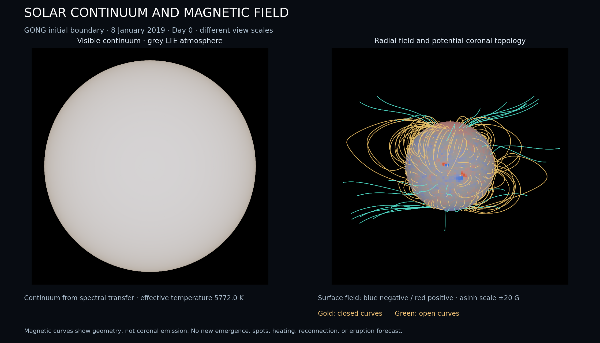

# Solar accuracy improvements and physical renders

October 5, 2026, extending the [initial gravity/solar implementation](gravity_solar.md).

[Open the movie viewer](solar_render/index.html),
[fixed-camera transport](solar_render/transport.mp4), or
[inspection turntable](solar_render/inspection.mp4).
The camera turntable is explicitly separate from solar rotation.



## Physics changes

Magnetic diffusion now uses second-order L-stable SDIRK instead of
Crank–Nicolson. Stiff modes decay rather than retaining large alternating
amplitudes. Both stages reuse cached tridiagonal factors, shared by positive
and negative Fourier modes. A stiff dipole test retains the constant mean and
damps the varying component below 0.003 in one deliberately oversized step.
Accuracy still requires time refinement; L-stability is not an error guarantee.
The [MOOSE method reference](https://mooseframework.inl.gov/source/timeintegrators/LStableDirk2.html)
describes this two-stage closure.

The coronal fit now integrates the area of each magnetogram cell. It uses
polar-regular Gaussian quadrature in theta and exact longitude cell integrals,
including their sinc factor. Treating averaged observations as point values
gave a polar field of 0.48828125 for an eight-cell north/south step boundary
projected through degree three. Its analytic answer is 0.625; the new test
matches that value within 1e-12. The projection is exact for the represented
cell boundary to quadrature accuracy, not for unresolved observations or the
full untruncated field.

Adaptive coronal tracing integrates `dx/ds=±B/|B|`. RK4 step doubling estimates
local position error; boundary refinement stops at the photosphere or source
surface without sampling beyond the field's physical domain. Near-null,
length, step and underflow outcomes remain explicit. Only two photospheric
endpoints count as a closed curve, and a photosphere/source pair counts as
open. The analytic dipole flux function remains constant along traced curves
within the test tolerance. Azimuthal harmonic powers are reused across degrees,
reducing repeated trigonometric work in field queries.

## Continuum and diagnostic rendering

The continuum uses a plane-parallel Eddington grey LTE atmosphere:

```text
T(tau)^4 = (3/4) Teff^4 (tau + 2/3)
I_lambda(mu) = integral exp(-u) B_lambda(T(mu*u)) du
I_bol(mu) = 3 sigma Teff^4/(4 pi) (mu + 2/3)
```

The formal spectral transfer integral uses 32-point Gauss-Laguerre quadrature,
and visible radiance is integrated through the existing approximate CIE 1931
response. Nominal luminosity/radius set Teff=5772.003 K. Bolometric integration
recovers `sigma*Teff^4`, with limb/center intensity ratio 0.4. Independent
visible-wavelength transfer integration and integration over wavelength check
quadrature accuracy and energy normalization. [MESA's atmosphere documentation](https://docs.mesastar.org/en/24.03.1/atm/t-tau.html)
states the temperature closure; [NumPy's quadrature documentation](https://numpy.org/doc/2.1/reference/generated/numpy.polynomial.laguerre.laggauss.html)
documents the rule used to generate pinned nodes/weights.

The separate magnetic image uses the actual radial cell field, with a symmetric
asinh scale clipped at ±20 G. Gold curves are closed, green curves open, and
grey curves unresolved. These colors and line brightness encode geometry;
they are not visible/EUV emissivity. Equal-area seed counts are not flux
fractions. An opaque photosphere hides rear footpoints and curves.

The two views use different scales: a close continuum disk and a wider magnetic
volume. Projection uses straight orthographic rays. The particle geodesic solver
is separate; GR light propagation is not applied to these renders. There are
no fabricated spots, granulation, heating, spectral lines or coronal emission.
The grey approximation is not a measured line-blanketed solar spectrum.

The runtime HTML viewer provides a time slider over PNG snapshots. A separate
PFM retains unexposed linear continuum RGB radiance. Exposure, Reinhard mapping
and sRGB conversion affect PNG presentation only. Pixel quadrature and the
angle lookup have discretization error, with no claimed Monte Carlo error bar.

## Recorded run and validation

Both movies contain 28 snapshots from day 0 through day 27, initialized from the
bundled GONG map without later observations or new emergence. The transport
view fixes Carrington longitude 220° and latitude 7°. The inspection view
rotates the camera once, with the same simulated fields. Per-frame PNGs are
900×900 with 2×2 pixel quadrature. PFSS degree is 10, source radius 2.5 R, and
there are 240 fixed equal-area seeds. Local trace tolerance is 1e-6 R; it is not
a rigorous global trajectory error bound.

All seeds reached classified boundaries in all 28 frames. Day zero has 206
closed and 34 open curves; day 27 has 210 closed and 30 open curves. These counts
describe the selected geometry, not an eruption or open-flux probability.
The day-27 axial dipole is 1.247929038 G and signed-flux drift is 1.456 Wb.
Single recorded executions, including image/map/trace exports, took 3.223 s
with a fixed camera and 3.093 s with the turntable (`RAYON_NUM_THREADS=8`, release
build). Compilation and movie encoding are excluded. These are machine-specific
execution timings, not operational forecasting benchmarks.

[Fixed-view metadata](solar_render/metadata.json),
[inspection metadata](solar_render/inspection_metadata.json), and
[per-frame diagnostics](solar_render/frames.csv) accompany the artifacts.

The six affected crates pass **135 library/integration tests**, including 17
solar tests. Strict solar Clippy passes across all targets, and formatting
passes. The new checks cover stiff diffusion, coarse cell-area projection,
analytic field-line connectivity/invariants, flux-normalized limb darkening,
independent spectral integrals, and rear-geometry occultation.

The dated GONG transport comparison remains mixed: updated full-map RMSE is
2.935805626 G versus persistence 3.424812275 G (MSE skill 0.265179855), while
the axial-dipole forecast is still worse than persistence. No parameters were
fit to the target. A single synoptic-map comparison does not establish cycle
prediction skill.

This remains prescribed surface transport with a potential corona and a static
solar background. Full dynamo induction, composition/nuclear evolution,
convective/radiative energy transport, nonpotential currents, heating,
reconnection and observational forecast calibration remain needed for an
emergent predictive Sun. The movie's changing field curves do not model plasma
motion, reconnection or flares.

## Reproduce

From `fluid/`:

```sh
RAYON_NUM_THREADS=8 cargo run -p solar --release --example render -- /tmp/solar-render-fixed 28
RAYON_NUM_THREADS=8 cargo run -p solar --release --example render -- /tmp/solar-render-orbit 28 orbit
RAYON_NUM_THREADS=8 cargo test -p gravity -p solar -p standard-model -p compressible -p radiation -p semiconductor --release --lib --tests
cargo clippy -p solar --all-targets --no-deps -- -D warnings
cargo fmt --check -p solar
```

From the repo root (export uses matplotlib, ffmpeg with libx264/drawtext, and
the installed DejaVu Sans font):

```sh
python3 analysis/export_solar_render.py /tmp/solar-render-fixed analysis/solar_render /tmp/solar-render-orbit
```

Open `/tmp/solar-render-fixed/index.html` for the snapshot slider and raw SI
map/trace/PFM exports. The archived viewer contains the two movies and their
metadata; regenerate the runtime directory for the larger raw datasets.
